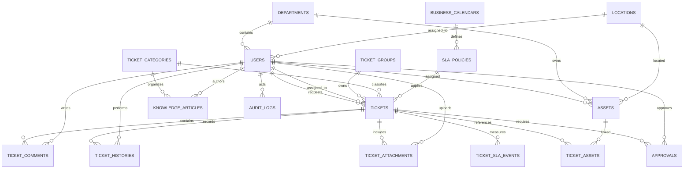

# Entity Relationship Diagram

## Catatan
- Satu tiket memiliki satu requester dan dapat memiliki satu assignee utama serta satu group.
- Jika satu tiket dapat memengaruhi banyak aset, gunakan `ticket_assets`; hindari mengandalkan satu kolom `asset_id`.
- `ticket_histories` menyimpan timeline operasional. `audit_logs` menyimpan jejak tindakan keamanan/administratif. Keduanya memiliki tujuan berbeda.
- Approval dapat mempunyai beberapa baris per tiket bila multi-level approval dibutuhkan.
- User/department/location dapat dinonaktifkan tanpa menghapus tiket historis.
